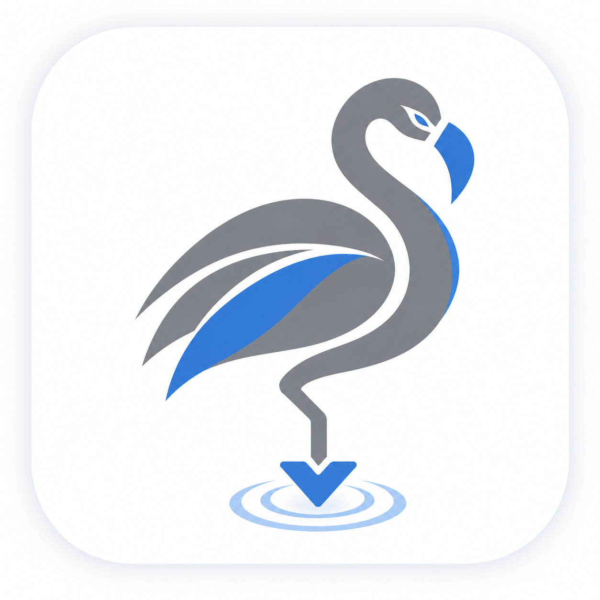
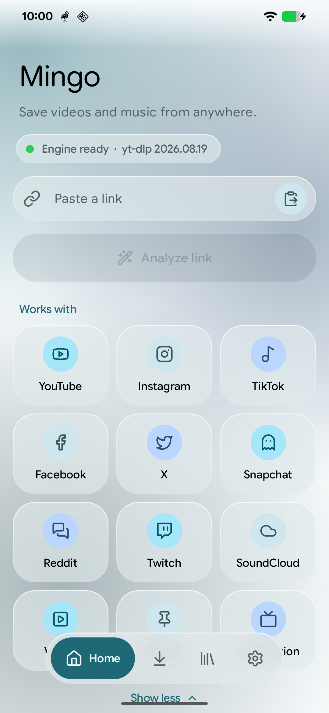
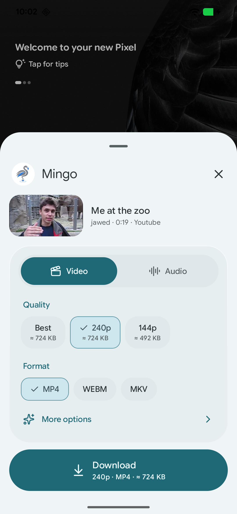
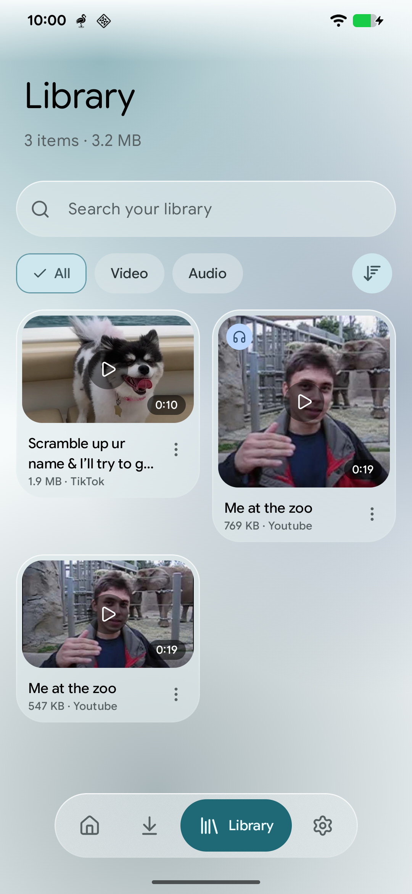
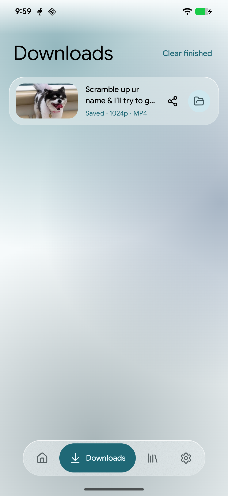
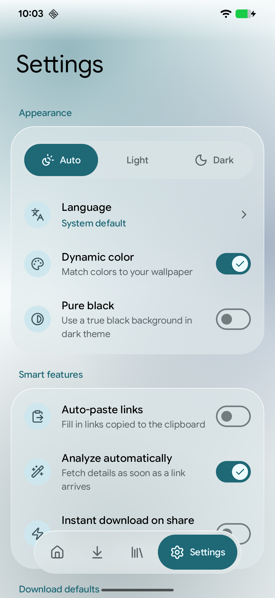
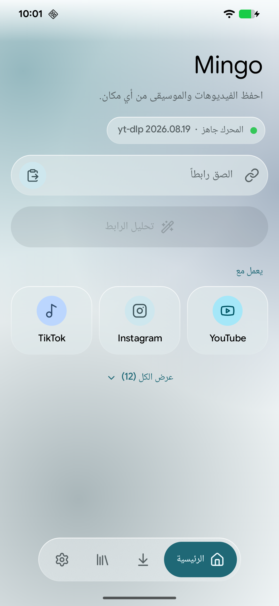
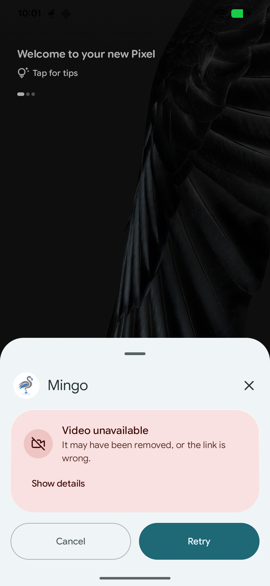
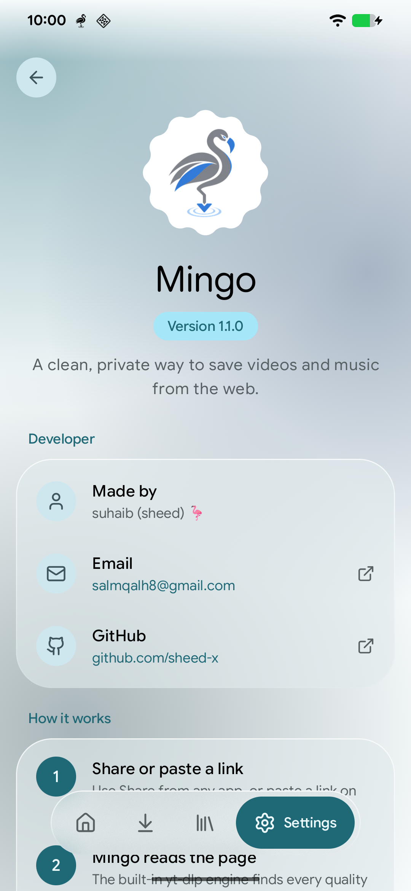

<div align="center">



# Mingo

**A clean, private way to save videos and music from the web.**

Paste or share a link from YouTube, TikTok, Instagram and 1,000+ other sites, pick the quality you want, and Mingo does the rest — in a modern Material 3 Expressive design inspired by Pixel apps.


</div>

---

## ✨ Features

- **Video or audio** — MP4, WEBM, MKV video up to 8K, or MP3, M4A, Opus, FLAC and WAV audio with a choice of bitrate.
- **Real qualities, real sizes** — every resolution the site actually offers, with the estimated file size before you download.
- **Download from any app** — tap *Share → Download with Mingo* and a small sheet opens on top of the app you're in. No need to leave it.
- **Instant mode** — optionally skip the sheet and download straight away with your defaults.
- **Smart clipboard** — copied links are detected and analyzed automatically.
- **Background downloads** with progress notifications, cancel and retry.
- **Library** — search, filter (video / audio), sort, play in the built-in player, share, open with another app, re-download or delete.
- **Extras** — embed thumbnails/cover art, metadata, chapters and subtitles; skip sponsor segments on YouTube with SponsorBlock.
- **Always up to date** — the yt-dlp engine updates itself daily, because sites change often.
- **Clear errors** — "No internet connection", "This content is private", "Not available in your region"… instead of cryptic messages.
- **Beautiful & personal** — Material You dynamic color, light/dark/pure-black themes, floating glass navigation bar, Google Sans Flex.
- **14 languages** — English, العربية, Español, Français, Deutsch, Português, Русский, 简体中文, 日本語, 한국어, Türkçe, Bahasa Indonesia, हिन्दी, Italiano (with full right-to-left support).
- **Private by design** — no accounts, no ads, no analytics, no tracking.

## 📸 Screenshots

| Home | Share sheet | Library | Downloads |
|:---:|:---:|:---:|:---:|
|  |  |  |  |
| **Settings** | **Arabic (RTL)** | **Clear errors** | **About** |
|  |  |  |  |

## 📥 Download

Get the latest version from the [**Releases**](https://github.com/sheed-x/Mingo/releases) page.

| File | For |
|---|---|
| `Mingo-x.y.z-arm64-v8a.apk` | **Most phones from the last ~8 years — pick this if unsure** |
| `Mingo-x.y.z-armeabi-v7a.apk` | Older 32-bit phones |
| `Mingo-x.y.z-x86_64.apk` / `x86.apk` | Some tablets, Chromebooks and emulators |
| `Mingo-x.y.z-universal.apk` | Works on every device, but is much larger |

**Requirements:** Android 7.0 (Nougat) or newer. Optimized for Android 16.

### "App blocked to protect your device"?

Mingo isn't on Google Play (Google doesn't allow video downloaders there), so **Google Play Protect** may warn that it doesn't know the developer. This is expected for apps installed from outside the Play Store.

1. On the warning, tap **More details → Install anyway**.
2. If there is no such option: open **Play Store → your profile → Play Protect → ⚙️**, temporarily turn off **Scan apps with Play Protect**, install Mingo, then turn it back on.

Mingo is open source — you can read every line of code in this repository, or build it yourself.

## 🛠️ How it works

1. **You share or paste a link.**
2. **Mingo reads the page** with the built-in [yt-dlp](https://github.com/yt-dlp/yt-dlp) engine to find every available quality and format.
3. **You pick what you want** — video or audio, resolution, format and extras.
4. **It downloads in the background.** [FFmpeg](https://ffmpeg.org) merges and converts the file, which is saved to `Download/Mingo` and your Library.

Everything runs on your phone. There is no Mingo server.

## 🧱 Building from source

Requirements: Android Studio (or the Android SDK) and JDK 17+.

```bash
git clone https://github.com/sheed-x/Mingo.git
cd Mingo
./gradlew assembleDebug
```

Debug APKs are written to `app/build/outputs/apk/debug/`.

Release builds are signed with the key described in a local `keystore.properties` file (never committed):

```properties
storeFile=/path/to/your-release.jks
storePassword=…
keyAlias=…
keyPassword=…
```

Without that file, `./gradlew assembleRelease` produces unsigned APKs.

### Tech stack

Kotlin · Jetpack Compose · Material 3 Expressive · WorkManager · DataStore · Media3 (ExoPlayer) · Coil · Navigation Compose

## 🙏 Credits

Mingo stands on the shoulders of these great open-source projects:

- [yt-dlp](https://github.com/yt-dlp/yt-dlp) — the download engine
- [youtubedl-android](https://github.com/JunkFood02/youtubedl-android) — yt-dlp, Python and FFmpeg packaged for Android
- [FFmpeg](https://ffmpeg.org) — merging and converting media
- [Haze](https://github.com/chrisbanes/haze) — the frosted-glass effect
- [Lucide](https://lucide.dev) — icons
- [Google Sans Flex](https://fonts.google.com/specimen/Google+Sans+Flex) — typeface (SIL Open Font License)
- [SponsorBlock](https://sponsor.ajay.app) — community-sourced sponsor segments

## ⚖️ Disclaimer

Mingo is a tool. Only download content you own or have permission to use, and respect each platform's terms of service and creators' rights. The developer is not responsible for how the app is used.

## 📄 License

Mingo is free software, released under the [GNU General Public License v3.0](LICENSE).

## 👤 Developer

**suhaib (sheed)** 🦩

- GitHub: [@sheed-x](https://github.com/sheed-x)
- Email: [salmqalh8@gmail.com](mailto:salmqalh8@gmail.com)

Found a bug or have an idea? [Open an issue](https://github.com/sheed-x/Mingo/issues) or send an email.

---

